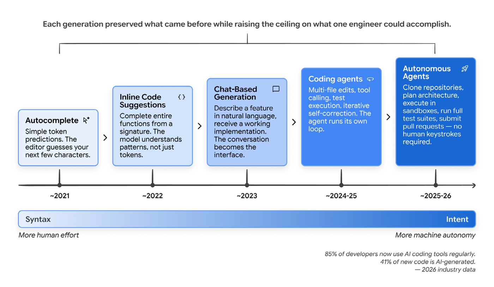
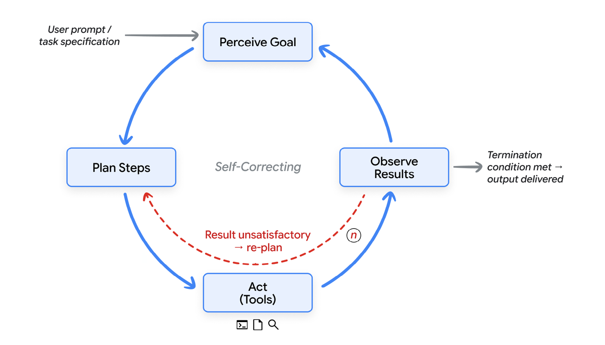
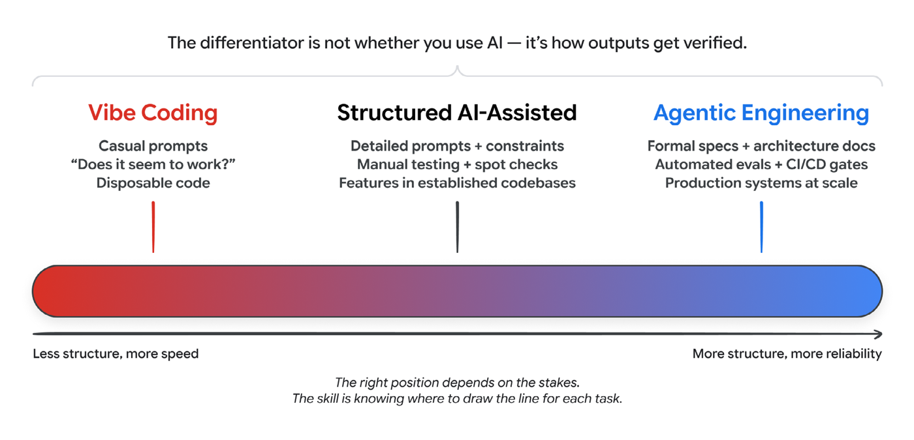
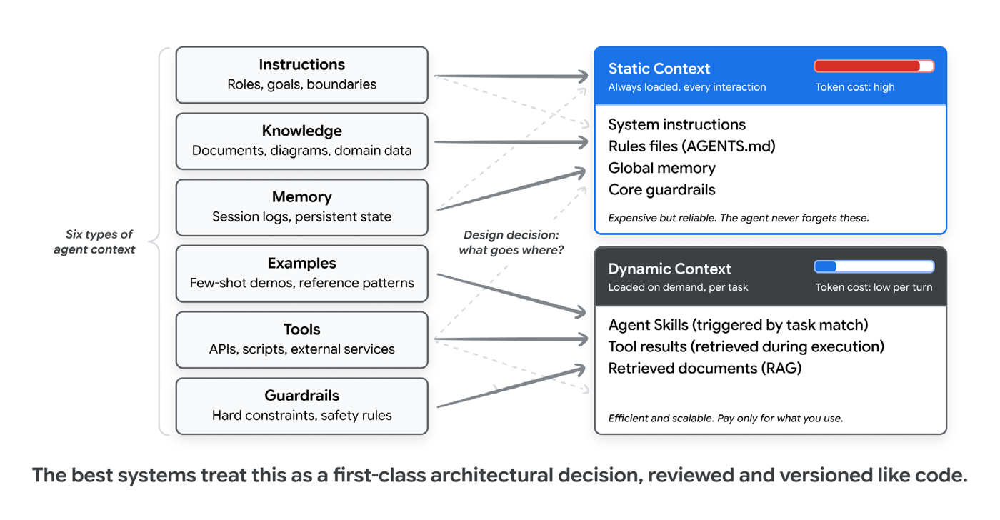
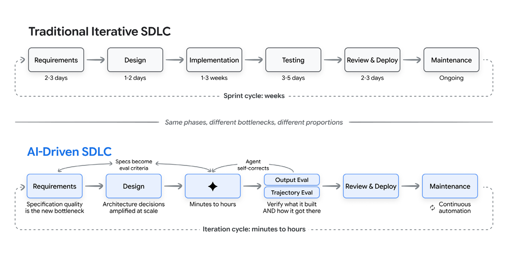
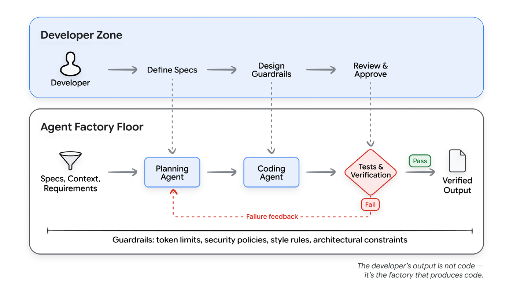
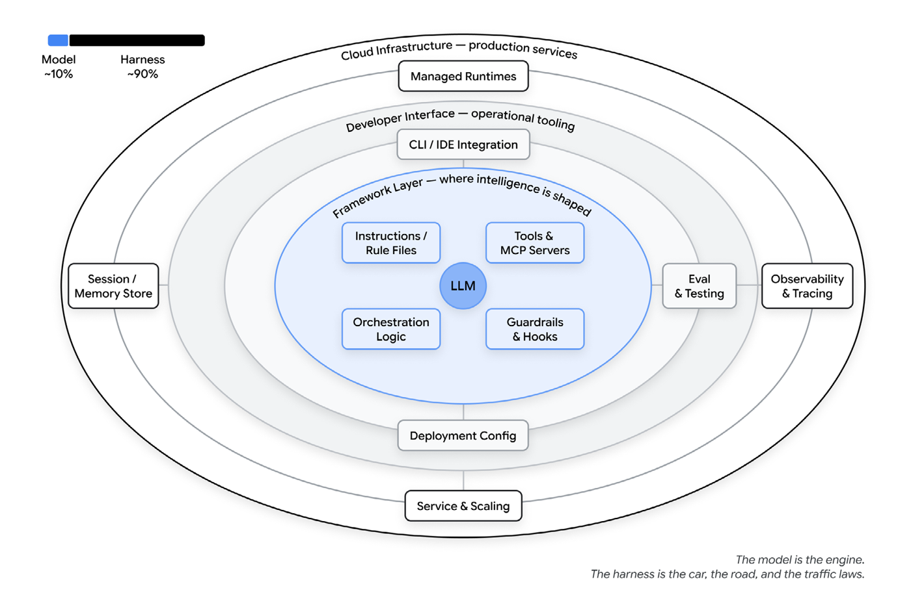
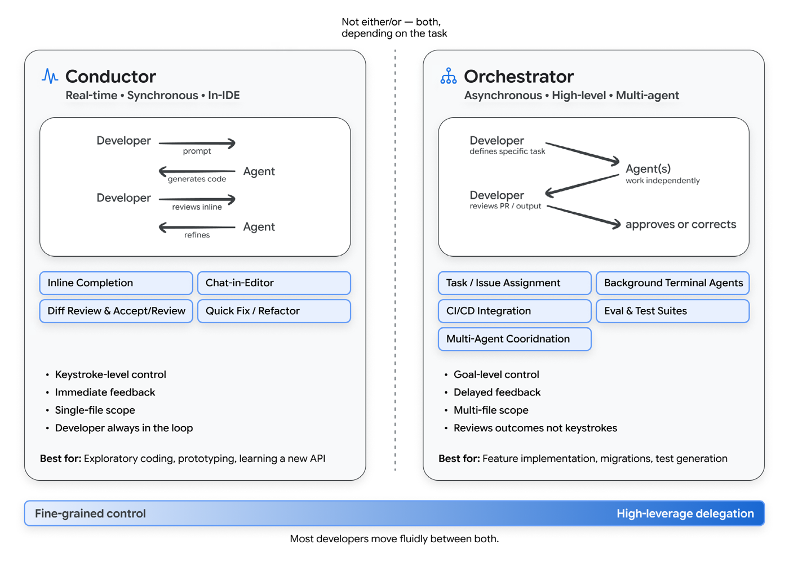
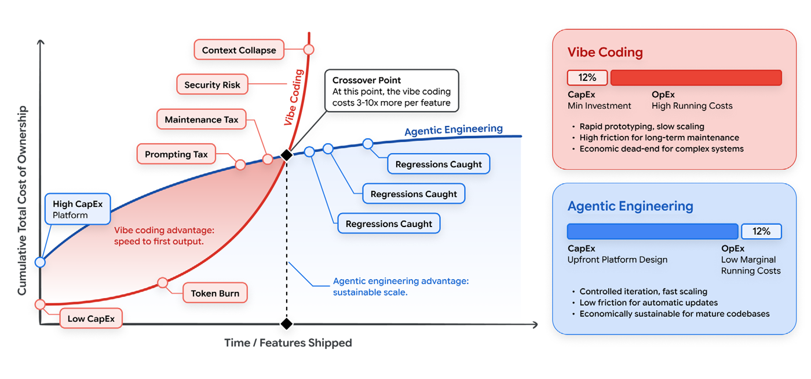

# 바이브 코딩 시대의 새로운 SDLC
### 즉흥적 프롬프팅에서 에이전틱 엔지니어링으로

> **원본 출처**
> - 원제: *The New SDLC With Vibe Coding — From ad-hoc prompting to Agentic Engineering*
> - 저자: Addy Osmani, Shubham Saboo, Sokratis Kartakis
> - 발행: Google, 2026년 5월 (Kaggle × Google 5일 AI 에이전트 집중 과정 Day 1 백서)
> - 원문: <https://www.kaggle.com/whitepaper-the-new-SDLC-with-vibe-coding>
> - 콘텐츠 기여: Elia Secchi, Julia Wiesinger, Anant Nawalgaria · 큐레이션·편집: Anant Nawalgaria · 디자인: Michael Lanning
>
> 이 문서는 위 원문을 한국어로 옮긴 비공식 번역본입니다. 원문의 저작권은 Google과 저자들에게 있으며, 정확한 내용은 원문을 기준으로 합니다. 그림은 원문 그림을 그대로 사용했고(그림 속 글자는 영어), 그림 설명만 한국어로 번역했습니다. 제품명·도구명·파일명 등 고유명사와 미주의 서지 정보는 원어를 유지했습니다.

## 목차

- [서론](#서론)
  - [왜 이 백서인가, 왜 지금인가](#왜-이-백서인가-왜-지금인가)
  - [이 백서의 대상 독자](#이-백서의-대상-독자)
- [문법에서 의도로의 전환](#문법에서-의도로의-전환)
- [AI 에이전트: 간단한 복습](#ai-에이전트-간단한-복습)
- [바이브 코딩이란 무엇인가?](#바이브-코딩이란-무엇인가)
  - [스펙트럼: 바이브 코딩에서 에이전틱 엔지니어링까지](#스펙트럼-바이브-코딩에서-에이전틱-엔지니어링까지)
- [컨텍스트 엔지니어링: 진짜 핵심 역량](#컨텍스트-엔지니어링-진짜-핵심-역량)
- [새로운 소프트웨어 개발 수명 주기](#새로운-소프트웨어-개발-수명-주기)
  - [압박받는 전통적 SDLC](#압박받는-전통적-sdlc)
  - [AI가 각 단계를 어떻게 바꾸는가](#ai가-각-단계를-어떻게-바꾸는가)
  - [팩토리 모델: 소프트웨어를 만드는 시스템을 만들기](#팩토리-모델-소프트웨어를-만드는-시스템을-만들기)
- [하네스 엔지니어링: 모델을 둘러싼 것](#하네스-엔지니어링-모델을-둘러싼-것)
  - [하네스에는 무엇이 들어 있나](#하네스에는-무엇이-들어-있나)
  - [SDLC 속의 하네스](#sdlc-속의-하네스)
- [진화하는 개발자의 역할: 컨덕터와 오케스트레이터](#진화하는-개발자의-역할-컨덕터와-오케스트레이터)
  - [컨덕터: 직접 참여하는 실시간 지휘](#컨덕터-직접-참여하는-실시간-지휘)
  - [오케스트레이터: 비동기 멀티 에이전트 위임](#오케스트레이터-비동기-멀티-에이전트-위임)
  - [80% 문제](#80-문제)
- [실전 속의 코딩 에이전트](#실전-속의-코딩-에이전트)
- [개발자의 하루 속 코딩 에이전트의 자리](#개발자의-하루-속-코딩-에이전트의-자리)
  - [바이브 코딩으로 프로덕션급 에이전트 만들기](#바이브-코딩으로-프로덕션급-에이전트-만들기)
- [AI 개발의 경제학](#ai-개발의-경제학)
  - [바이브 코딩의 숨겨진 부채 (낮은 CapEx, 높은 OpEx)](#바이브-코딩의-숨겨진-부채-낮은-capex-높은-opex)
  - [에이전틱 엔지니어링이라는 투자 (높은 CapEx, 낮은 OpEx)](#에이전틱-엔지니어링이라는-투자-높은-capex-낮은-opex)
  - [재무적 지렛대로서의 컨텍스트 엔지니어링](#재무적-지렛대로서의-컨텍스트-엔지니어링)
  - [동적 컨텍스트와 스킬을 통한 효율 확장](#동적-컨텍스트와-스킬을-통한-효율-확장)
  - [지능형 모델 라우팅](#지능형-모델-라우팅)
- [어디서부터 시작할 것인가](#어디서부터-시작할-것인가)
  - [개인 개발자를 위해](#개인-개발자를-위해)
  - [엔지니어링 리더를 위해](#엔지니어링-리더를-위해)
  - [조직을 위해](#조직을-위해)
- [결론: 새로운 인터페이스로서의 의도](#결론-새로운-인터페이스로서의-의도)
- [미주](#미주)

---

> 소프트웨어 엔지니어링에서 가장 근본적인 변화는 새로운 언어나 프레임워크, 클라우드 서비스가 아니다. 그것은 코드를 작성하는 일에서 의도를 표현하는 일로의 전환이며, 그 의도를 실제로 동작하는 소프트웨어로 옮겨 주는 지능형 시스템을 신뢰하는 일로의 전환이다.

## 서론

컴퓨팅 역사의 대부분 동안 프로그래밍은 일종의 번역 행위였다. 문제를 사람의 언어로 이해하고, 해법을 추상적인 용어로 설계한 다음, 기계가 실행할 수 있는 문법으로 옮기는 것이다. 각 단계마다 마찰이 생긴다. 그런데 이제 그 마찰이 무너지고 있다. 소프트웨어 엔지니어링은 고급 프로그래밍 언어의 등장 이후 가장 큰 변혁을 겪고 있다. 수십 년 동안 개발자가 기계와 소통하는 주된 인터페이스는 문법이었다. 중괄호, 세미콜론, 타입 표기, 그리고 프로그래밍 언어의 엄밀한 문법 말이다. 그 시대가 끝나가고 있다.

개발자가 *어떻게* 만들지가 아니라 *무엇을* 만들고 싶은지를 표현하는 새로운 패러다임이 도래했다. 구현은 기계가 맡는다. 인간은 의도와 아키텍처, 그리고 판단을 제공한다. 이는 먼 미래의 이야기가 아니라, 빠르게 늘어나는 전문 개발자들의 일상적 현실이다. 2026년 초 기준으로 전문 개발자의 85%가 AI 코딩 에이전트를 정기적으로 사용하고, 51%는 매일 사용하며, 새로 작성되는 코드의 약 41%가 AI가 생성한 것으로 추정된다.<sup>1</sup>

이 변화는 하룻밤 사이에 일어나지 않았다. 시작은 자동 완성, 즉 에디터 안에서의 단순한 토큰 예측이었다. 이어서 함수 전체를 완성할 수 있는 인라인 코드 제안이 등장했다. 다음으로 채팅 기반 인터페이스가 나와 개발자가 자연어로 기능을 설명하면 동작하는 구현을 받을 수 있게 되었다. 이제는 완전 자율 에이전트가 저장소를 복제하고, 여러 파일에 걸친 변경을 계획하고, 샌드박스 환경에서 이를 실행하고, 테스트를 돌리고, 풀 리퀘스트까지 제출한다. 사람이 코드 한 줄 입력하지 않고도 말이다.



*그림 1: 자동 완성에서 자율성으로 (From Autocomplete to Autonomy)*

이것이 소프트웨어 개발 수명 주기(SDLC)에 미치는 영향은 심대하다. 요구사항 수집부터 배포, 유지보수에 이르는 모든 단계가 AI의 역량에 의해 재편되고 있다. 그러나 이 변혁은 균일하지도, 단순하지도 않다. 그 스펙트럼은 개발자가 AI에게 프롬프트를 던지고 돌아오는 것을 그대로 받아들이는 가벼운 “바이브 코딩(vibe coding)”에서부터, 제약·테스트·피드백 루프로 정교하게 설계된 시스템 안에서 AI가 강력한 구현 엔진으로 동작하고 인간은 아키텍처·정확성·품질에 대한 감독권을 유지하는 규율 있는 “에이전틱 엔지니어링(agentic engineering)”까지 펼쳐져 있다.

이 구분은 중요하다. CTO에게 팀이 결제 처리 시스템을 바이브 코딩하고 있다고 말하면 경보가 울릴 것이고, 또 울려야 마땅하다. 반면 같은 CTO에게 팀이 에이전틱 엔지니어링을 실천하고 있다고, 즉 인간이 설계한 제약 아래에서 AI가 구현을 맡고 테스트 커버리지가 정확성을 보장한다고 말한다면, 이는 근본적으로 다른 대화가 된다.

이 백서는 그 대화를 위한 토대를 제공한다. 가벼운 바이브 코딩에서 규율 있는 에이전틱 엔지니어링에 이르는 스펙트럼을 추적하고, 개발자의 역할이 코드 작성에서 판단 행사로—컨덕터에서 오케스트레이터로—어떻게 이동하는지 살펴보며, 실제로 믿고 쓸 수 있는 소프트웨어를 만들어 내는 방식으로 이러한 도구를 도입하려면 무엇이 필요한지 제시한다.

### 왜 이 백서인가, 왜 지금인가

새로운 도구와 역량, 패러다임이 매주 등장한다. 엔지니어링 팀에게는 이 지형을 이해할 프레임워크가 필요하다. 몇 달 만에 낡아 버릴 스냅샷이 아니라, 구체적인 도구가 진화하더라도 여전히 유용한 원칙과 멘탈 모델 말이다.

### 이 백서의 대상 독자

이 백서는 AI가 SDLC를 어떻게 재편하고 있는지 이해하고, 프로덕션 소프트웨어가 요구하는 규율을 희생하지 않으면서 이러한 새로운 역량을 도입하고자 하는 소프트웨어 엔지니어, 엔지니어링 매니저, 아키텍트, 기술 리더를 위한 것이다. 독자가 현대적인 소프트웨어 개발 관행에는 익숙하지만 AI나 머신러닝의 세부 사항에는 익숙하지 않다고 가정한다.

## 문법에서 의도로의 전환

더 나아가기 전에, 에이전트가 무엇이고 바이브 코딩이 실제로 무엇을 의미하는지에 대한 공통된 그림이 필요하다. 두 용어 모두 여러 의미가 덧붙여져 있어 신중하게 풀어볼 필요가 있다.

## AI 에이전트: 간단한 복습

AI 에이전트란 목표를 인식하고, 그 목표에 도달하기 위한 단계를 계획하고, 도구를 통해 행동하고, 결과를 관찰하며, 목표가 달성되거나 중단 조건에 이를 때까지 반복하는 소프트웨어 시스템이다. 챗봇이 응답을 생성한 뒤 다음 프롬프트를 기다리는 반면, 에이전트는 자신의 루프를 스스로 돌린다. 맨 위에서 목표를 주면, 매 단계에서 무엇을 할지 에이전트가 결정한다.



*그림 2: 에이전트 루프 — 인식, 계획, 행동, 관찰, 반복 (The Agent Loop)*

단순하든 정교하든 모든 에이전트는 다섯 가지 요소로 구성된다. 2025년 11월에 발간된 「Introduction to Agents」 백서가 각 요소를 깊이 있게 다룬다.<sup>2</sup> 여기서는 간단히 요약한다.

- **모델**은 추론 엔진이다. 현재 컨텍스트를 읽고, 다음에 무엇이 일어나야 할지 결정하며, 다음 생각·다음 도구 호출·다음 메시지를 생성한다.
- **도구**는 모델을 세상과 연결한다. 에이전트가 호출할 수 있는 API, 실행할 수 있는 코드, 조회할 수 있는 데이터베이스, 작업을 위임할 수 있는 다른 에이전트가 여기에 포함된다.
- **메모리**는 상태다. 에이전트가 과거 상호작용을 기억하고, 프로젝트별 규칙을 불러오고, 세션을 넘어 컨텍스트를 유지하게 하여 결코 백지에서 시작하지 않도록 한다.
- **오케스트레이션**은 루프를 실행하는 코드다. 모델 호출마다 컨텍스트를 조립하고, 도구 호출을 디스패치하고, 그 결과를 수집하며, 계속할지 여부를 결정한다.
- **배포**는 프로토타입을 서비스로 바꾸는 요소다. 호스팅, 아이덴티티, 관측성(observability), 그리고 에이전트가 실행되는 프로덕션 인프라를 말한다.

이 요소들은 하나의 연속된 루프 안에서 함께 작동한다. 임무를 받고, 상황을 살피고, 충분히 생각하고, 행동하고, 관찰하고 반복한다. 이 루프가 모든 에이전트의 심장이다. 이 백서의 나머지 내용, 그리고 이 과정의 나머지 전체가 이 루프의 변주다.

## 바이브 코딩이란 무엇인가?

2025년 2월, 안드레이 카파시(Andrej Karpathy)는 소프트웨어 엔지니어링 커뮤니티 전반에 폭넓은 반향을 일으킨 새로운 프로그래밍 방식을 소개하는 글을 올렸다. 그는 “바이브에 완전히 몸을 맡기고, 지수적 성장을 받아들이고, 코드가 존재한다는 사실조차 잊어버리는” 접근법을 묘사했다. 이 방식에서 개발자는 원하는 것을 자연어로 설명하고, AI의 출력을 받아들이며, 무언가 고장 나면 오류 메시지를 복사해 프롬프트에 다시 붙여 넣고 AI에게 고쳐 달라고 요청한다.<sup>2</sup>

이 용어가 급속히 퍼진 이유는 실재하는 무언가를 포착했기 때문이다. 많은 개발자가 이미 이렇게 일하고 있었지만 이를 부를 말이 없었다. 몇 달 만에 “바이브 코딩”은 AI를 활용한 모든 개발 워크플로를 가리키는 흔한 표현이 되었고, 이는 혼란을 낳았다. 잘 정의된 기능을 구현하기 위해 AI 어시스턴트를 사용하는 시니어 엔지니어도 “바이브 코딩”을 하는 것일까? 신중하게 계획된 아키텍처를 실행하기 위해 AI 에이전트를 사용하는 팀은? 이 용어는 너무 넓게 적용되어 의미를 잃기 시작했다.

2026년 초에 이르러 카파시 본인도 원래의 정의가 너무 좁았음을 인정하고, 스펙트럼의 보다 규율 있는 끝을 설명하기 위해 “에이전틱 엔지니어링”이라는 용어를 도입했다.<sup>4</sup>

### 스펙트럼: 바이브 코딩에서 에이전틱 엔지니어링까지

바이브 코딩과 에이전틱 엔지니어링을 이분법으로 다루기보다는, 하나의 스펙트럼의 양 끝점으로 생각하는 편이 더 유용하다. 핵심 차별점은 AI를 사용하느냐가 아니다. AI의 출력을 얼마나 많은 구조와 검증, 인간의 판단이 둘러싸고 있느냐이다.

| 차원            | 바이브 코딩                                        | 구조화된 AI 지원 코딩                           | 에이전틱 엔지니어링                                                  |
|-----------------|----------------------------------------------------|-------------------------------------------------|----------------------------------------------------------------------|
| 의도 명세       | 가벼운 자연어 프롬프트                             | 예시와 제약을 포함한 상세한 프롬프트            | 공식 명세서, 아키텍처 문서, 메모리 파일                              |
| 검증            | “돌아가는 것 같은가?”                              | 수동 테스트, 부분 점검                          | 자동화된 테스트 스위트, CI/CD 게이트, LM 심사자(LM judge)            |
| 코드베이스 이해 | 최소한. 개발자가 생성된 코드를 읽지 않을 수도 있음 | 핵심 경로를 선별적으로 리뷰                     | 아키텍처에 대한 포괄적 리뷰. 구현 세부는 AI가 처리                   |
| 오류 처리       | 오류 메시지를 AI에 복사·붙여넣기                   | 개발자가 근본 원인을 진단하고, AI가 수정을 구현 | 정의된 범위 안에서 에이전트가 자가 진단. 아키텍처 문제는 인간이 처리 |
| 적합한 범위     | 프로토타입, 스크립트, 개인 프로젝트, 해커톤        | 기존 코드베이스 내 기능 개발                    | 프로덕션 시스템, 팀 규모 개발                                        |
| 위험 프로필     | 높음. 일회용 코드라면 허용 가능                    | 보통. 주요 체크포인트에서 인간이 판단           | 낮음. 모든 단계에서 체계적 검증                                      |

표 1: 바이브 코딩에서 에이전틱 엔지니어링까지의 스펙트럼



*그림 3: 바이브 코딩에서 에이전틱 엔지니어링까지의 스펙트럼 (The Vibe Coding to Agentic Engineering Spectrum)*

> **💡 실전 팁**  
> 이 스펙트럼에서 어디에 서야 하는지는 걸려 있는 위험의 크기에 달려 있다. 주말 프로토타입은 순수한 바이브 코딩이어도 된다. 금융 거래를 처리하는 프로덕션 API는 에이전틱 엔지니어링을 요구한다. 대부분의 실제 작업은 그 사이 어딘가에 있으며, 작업마다 어디에 선을 그을지 아는 것이 곧 실력이다.

양 끝을 가르는 가장 큰 차이는 출력을 어떻게 검증하느냐이다. 바이브 코딩에서 검증은 선택 사항이다. 개발자는 코드를 실행해 보고 맞는 것 같은지 확인한다. 에이전틱 엔지니어링에서는 두 가지 메커니즘이 함께 작동한다. **테스트**는 시스템의 결정론적 부분을 검증한다. 즉 어떤 입력이 주어지면 함수가 특정 출력을 내는지 확인한다. <strong>평가(eval)</strong>는 결정론적이지 않은 부분을 검증한다. 에이전트가 올바른 단계의 궤적(trajectory)을 밟았는지, 올바른 도구를 선택했는지, 품질 기준을 충족하는 최종 응답을 만들었는지를 본다. 테스트는 코드로 검사하고, 평가는 레이블된 데이터셋, 채점 루브릭, LM 심사자로 검사한다. 이 둘이 없다면, 프롬프트가 아무리 정교하더라도 그 방식은 언제나 바이브 코딩이다.

## 컨텍스트 엔지니어링: 진짜 핵심 역량

이 분야가 성숙해지면서 핵심적인 통찰이 드러났다. AI가 생성하는 코드의 품질은 프롬프트의 기발함보다 제공되는 컨텍스트의 품질에 훨씬 더 크게 좌우된다는 것이다. 이러한 깨달음에서 **컨텍스트 엔지니어링**이라는 개념이 탄생했다. 이는 코드베이스, 아키텍처, 컨벤션, 그리고 의도에 대한 풍부하고 구조화된 정보를 AI 에이전트에 제공하는 실천을 말한다.<sup>5</sup>

개발자는 여섯 가지 주요 컨텍스트 유형을 고려해야 한다.

- **지시(Instructions):** 에이전트의 핵심 역할, 목표, 운영상의 경계.
- **지식(Knowledge):** 검색된 문서, 아키텍처 다이어그램, 도메인 특화 데이터.
- **메모리(Memory):** 단기 세션 로그(방금 무슨 일이 있었는가)와 장기 영속 상태(이 프로젝트는 무엇인가).
- **예시(Examples):** 퓨샷(few-shot) 행동 시연과 코드베이스 참조 패턴.
- **도구(Tools):** 에이전트가 호출할 수 있는 API, 스크립트, 외부 서비스의 정확한 정의.
- **가드레일(Guardrails):** 강제 제약, 형식 규칙, 안전성 검증.

AI 코드 생성에서 컨텍스트 엔지니어링이란, 이 여섯 요소 중 무엇을 에이전트가 처음부터 갖고 있게 하고 무엇을 필요할 때 가져오게 할지 신중하게 균형을 잡는 일이다. 여기서 정적 컨텍스트와 동적 컨텍스트라는 중요한 구분이 생긴다.

**정적 컨텍스트**는 항상 로드된다. 시스템 지시, 규칙 파일(`AGENTS.md`, `CLAUDE.md`, `GEMINI.md`), 전역 메모리, 페르소나 정의가 여기에 해당한다. 정적 컨텍스트는 에이전트가 누구이고 어떻게 행동하는지를 정의한다. 모든 토큰이 관련성과 무관하게 모든 상호작용에 포함되므로 정적 컨텍스트는 비용이 크다.

**동적 컨텍스트**는 필요할 때 로드된다. 작업 매칭으로 트리거되는 스킬 지시, 실행 중에 가져오는 도구 결과, RAG 파이프라인에서 불러오는 문서, 윈도잉된 세션 기록이 여기에 해당한다. 정보가 필요할 때만 토큰 비용을 지불하므로 동적 컨텍스트는 효율적이다.

무엇을 정적 컨텍스트에 두고 무엇을 동적 컨텍스트에 둘지는 진정한 엔지니어링 트레이드오프다. 정적 컨텍스트가 너무 많으면 토큰이 낭비되고 신호가 희석된다. 너무 적으면 에이전트가 핵심 규칙을 잊는다. 가장 좋은 시스템은 이 경계를 일급(first-class) 아키텍처 결정으로 취급하여, 다른 설정과 마찬가지로 리뷰하고 버전 관리한다.



*그림 4: 컨텍스트 엔지니어링 — 정적 컨텍스트 대 동적 컨텍스트 (Static vs. Dynamic)*

동적 컨텍스트를 관리하는 가장 강력한 패턴은 <strong>에이전트 스킬(Agent Skills)</strong>이다. 에이전트 스킬은 절차적 지식을 구조화하여 이식 가능하게 만든 패키지로, 작업이 필요로 할 때만 에이전트가 로드한다.

모든 전문 지식을 에이전트의 시스템 프롬프트에 욱여넣는 대신, 스킬을 사용하면 에이전트는 가벼운 제너럴리스트로 남아 있다가 점진적 공개(progressive disclosure)를 통해 필요에 따라 스페셜리스트 역할로 변신할 수 있다. 에이전트는 시작 시점에는 가벼운 메타데이터만 보고, 작업이 매칭되면 전체 지시를 로드하며, 명시적으로 필요할 때만 심층 참고 자료를 가져온다. 그 결과 에이전트는 수십 가지 전문 역량을 지니면서도 실제로 사용 중인 하나에 대해서만 토큰 비용을 지불한다.

에이전트 스킬은 AI 에이전트 개발을 괴롭혀 온 네 가지 문제를 해결하기 때문에 주요 코딩 에이전트와 엔터프라이즈 플랫폼 전반에서 빠르게 채택되었다.

- 과부하된 프롬프트로 인한 컨텍스트 부패(context rot)
- LLM에 절차적 메모리가 없다는 문제
- 멀티 에이전트 아키텍처의 운영 부담
- 도구와 벤더를 넘나드는 이식성의 필요

이 절에서는 컨텍스트 엔지니어링의 핵심 원칙, 즉 모든 에이전트가 필요로 하는 여섯 가지 컨텍스트 유형, 정적 컨텍스트와 동적 컨텍스트 사이의 트레이드오프, 그리고 그 트레이드오프를 대규모로 관리하는 핵심 패턴인 에이전트 스킬을 소개했다.

이 시리즈의 Day 3 자매 백서인 「Context Engineering: Sessions, Skills & Memory」는 이 아이디어들을 한층 더 깊이 다룬다. 세션을 설계하고 관리하는 법, 스킬을 작성하고 평가하는 법, 상호작용 전반에 걸친 영속 메모리를 구축하는 법, 프로덕션 시스템의 토큰 경제성을 최적화하는 법을 다룬다.

“프롬프트 엔지니어링”에서 “컨텍스트 엔지니어링”으로의 전환은 AI와 함께 일하는 것에 관한 더 깊은 진실을 반영한다. 모델에게 필요한 것은 교묘하게 다듬은 지시라기보다, 숙련된 인간 개발자가 좋은 일을 하는 데 필요한 것과 같은 컨텍스트다. 질문은 “어떻게 AI를 속여서 좋은 코드를 쓰게 할까?”가 아니다. “새로운 팀원이 효과적으로 기여하려면 무엇을 알아야 하며, 그 지식을 AI가 사용할 수 있는 형태로 어떻게 담아낼까?”이다.

컨텍스트 엔지니어링은 바이브 코딩과 에이전틱 엔지니어링을 잇는 다리다. 또한 이 절과 다음 절을 잇는 다리이기도 하다. 다음 절에서는 모든 모델을 둘러싸고 그것을 쓸모 있게 만드는 구조를 살펴본다.

문법을 작성하는 것에서 이 컨텍스트를 엔지니어링하는 것으로 초점을 옮기면, 소프트웨어 제작의 병목이 근본적으로 달라진다. 우리는 더 이상 인간의 손이 보일러플레이트를 타이핑하기를 기다리지 않는다. 인간의 머리가 경계를 정의하기를 기다린다. 이는 전통적인 소프트웨어 개발 수명 주기(SDLC)를 완전히 다시 상상할 것을 요구한다. 이제는 소프트웨어를 만드는 데 사용하는 시스템이 그 소프트웨어가 전달되는 속도를 결정하기 때문이다.

## 새로운 소프트웨어 개발 수명 주기

### 압박받는 전통적 SDLC

소프트웨어 개발 수명 주기는 이미 한 차례 큰 변혁을 겪었다. 지난 20년간 대부분의 기업은 순차적인 워터폴 프로세스에서 반복적 모델로 옮겨 갔다. 애자일 스프린트, 지속적 통합, 데브옵스 파이프라인, 빠른 릴리스 주기가 그것이다. 그 전환은 피드백 루프를 단축했고, 테스트를 개발 가까이로 끌어왔으며, 배포를 분기마다의 이벤트가 아닌 지속적인 과정으로 만들었다.

AI는 이 주기를 극적으로, 그러나 고르지 않게 압축한다. 몇 주씩 걸리던 구현은 이제 몇 시간 만에 끝날 수 있지만, 요구사항·아키텍처·검증은 여전히 완고하게 인간의 속도로 진행된다. 그 결과는 기존 SDLC의 더 빠른 버전이 아니다. 단계 사이의 경계가 흐려지고, 반복 주기가 몇 주에서 몇 분으로 짧아지며, 개발자의 역할이 주된 구현자에서 시스템 설계자이자 품질 결정권자로 이동하는, 전혀 다른 워크플로다.



*그림 5: 전통적 SDLC 대 AI 주도 SDLC (Traditional SDLC vs. AI-Driven SDLC)*

> **변화 속도에 대한 참고:** 위에서 설명한 단계별 그림은 2026년 중반 시점의 AI 주도 SDLC 상태를 반영한다. 이는 빠르게 변하고 있다. 초기 징후를 보면 압축이 구현 단계를 넘어 확산될 것으로 보인다. 이미 일부 팀은 개발자가 명세에서 곧바로 리뷰로 넘어가고, 구현·테스트·배포는 백그라운드에서 AI 에이전트가 처리하는 워크플로를 실험하고 있다. 이 절에서 그린 경계는 12개월 후에는 다르게 보일 수 있다. 변하지 않을 것은 기계가 구현을 더 많이 맡게 될수록 더 중요해지는 인간의 판단력, 안목, 그리고 AI 출력을 검증하는 역량이다.

### AI가 각 단계를 어떻게 바꾸는가

#### 요구사항과 계획

요구사항 단계는 역사적으로 의도와 구현 사이의 간극이 가장 컸던 단계다. 비즈니스 요구를 기술 명세로 옮기는 일은 수작업이며 오류가 발생하기 쉬운 과정이었고, 이해관계자가 원하는 것과 엔지니어가 만드는 것 사이에 끈질긴 간극을 만들었다.

현대의 AI 도구는 요구사항 정제에 직접 참여할 수 있다. 제품 브리프에서 사용자 스토리를 생성하고, 사람이 놓치는 엣지 케이스를 찾아내고, 자연어 설명으로부터 API 스키마를 만들고, 명세 문서로부터 인터랙티브 프로토타입을 생성한다. 에이전틱 개발 환경에서는 개발자가 설명에서 동작하는 프로토타입까지 몇 분 만에 갈 수 있어, 요구사항에서 프로토타입으로 이어지는 피드백 루프가 거의 0으로 줄어든다.

요구사항은 더 이상 팀 사이에 넘겨지는 문서가 아니다. 명세와 초기 구현을 동시에 만들어 내는, 인간과 AI 사이의 대화가 된다.

#### 설계와 아키텍처

아키텍처는 SDLC에서 가장 완고하게 인간 중심적인 단계로 남아 있으며, 여기에는 타당한 이유가 있다. 아키텍처 결정은 본질적으로 트레이드오프에 관한 것이다. 일관성 대 가용성, 복잡성 대 유연성, 직접 구축 대 구매. 이러한 트레이드오프는 AI가 완전히 파악할 수 없는 비즈니스 맥락, 조직의 제약, 장기적 전략 고려 사항에 달려 있다.

AI는 일단 내려진 아키텍처 결정을 구현하는 데 탁월하다. 명확한 아키텍처 문서가 주어지면 AI 에이전트는 애플리케이션 전체의 골격을 세우고, 모듈 전반에 일관된 패턴을 생성하며, 새 코드가 기존 컨벤션을 따르도록 보장할 수 있다. 개발자의 역할은 보일러플레이트를 작성하는 것에서, 그 보일러플레이트가 구현하는 구조적 결정을 내리고 문서화하는 것으로 이동한다.

#### 구현

현대의 코딩 에이전트는 자연어 설명으로부터 기능 전체를 생성하고, 복잡한 알고리즘을 구현하며, 서로 올바르게 맞물리는 여러 파일에 걸친 변경을 만들어 낼 수 있다. 생산성 향상은 실재한다. 업계 조사에 따르면 생산성이 25~39% 향상되었고, 일부 작업에서는 그 이상의 향상이 나타났다.<sup>7</sup>

그러나 실상은 헤드라인 수치가 시사하는 것보다 미묘하다. METR의 연구에 따르면, AI 어시스턴트를 사용한 숙련 개발자가 특정 작업에서 오히려 19% 더 오래 걸렸는데, 주된 원인은 AI 출력을 검증하고 디버깅하고 수정하는 데 드는 시간이었다.<sup>8</sup> AI는 구현 작업을 없앤다기보다, 그것을 작성하는 일에서 리뷰하고, 이끌고, 검증하는 일로 바꾼다.

#### 테스트와 품질 보증

AI가 생성한 코드를 테스트하려면 에이전트가 무엇을 만들었는지뿐 아니라 그것에 어떻게 도달했는지도 평가해야 한다. 출력 평가는 최종 산출물을 확인한다. 코드가 컴파일되는가, 테스트를 통과하는가? 궤적 평가는 도구 호출과 중간 추론의 전체 순서를 확인한다. 두 가지 모두 필요한 이유는, 검증 단계를 건너뛴 채 매끄러워 보이는 출력이 눈에 보이는 오류가 있는 출력보다 더 위험한 실패이기 때문이다.

AI는 테스트 생성 자체도 바꾼다. 에이전트는 사람이 떠올리지 못할 수 있는 엣지 케이스와 속성 기반 테스트를 포함한 테스트 케이스를 만들어 낼 수 있다. 더 중요한 것은, 테스트와 평가가 AI 에이전트에게 의도를 전달하는 주된 수단이 된다는 점이다. 잘 작성된 평가 스위트는 AI에게 “정확함”이 무엇을 의미하는지 알려 주고, 이를 자동으로 검증하는 방법을 제공한다.

이러한 관행은 지속적인 품질 플라이휠에 연결될 때 가장 효과적이다. 벤치마크 스위트로 평가하고, 근본 원인을 클러스터링하여 실패를 진단하고, 원인이 된 프롬프트나 도구를 최적화하고, 회귀 스위트로 수정 사항을 검증하고, 프로덕션 트래픽을 모니터링하여 새로운 실패 유형을 찾는다. 이 주기가 돌 때마다 효과가 복리로 쌓인다.

#### 코드 리뷰와 배포

리뷰 프로세스 자체도 강화되고 있다. AI가 1차 리뷰어 역할을 하면서, 인간 리뷰어가 코드를 보기 전에 잠재적 버그, 스타일 위반, 보안 취약점, 성능 문제를 식별한다. 설계·유지보수성·전략적 정합성에 관한 맥락 의존적 결정에는 여전히 인간의 판단이 필요하므로 이것이 인간의 리뷰를 대체하지는 않지만, 리뷰어의 인지 부담을 크게 줄여 준다.

배포 파이프라인도 AI를 인식하는 방향으로 진화하고 있다. AI 에이전트는 배포 상태를 모니터링하고, 문제가 있는 릴리스를 자동으로 롤백하며, 변경 사항의 성격과 범위에 따라 배포 위험을 예측할 수 있다. 현대의 배포 플랫폼은 AI 기반 관측성과 점점 더 통합되어, 프로덕션 동작과 개발 결정 사이의 피드백 루프를 만들어 낸다.

이 시리즈의 Day 5에서는 PR 물량이 에이전트의 출력량에 비례해 늘어날 때 인간 리뷰어에게 무엇이 달라지는지—묶음 요약, 조건부 LGTM, 에이전트 주도의 코드 리뷰 스킬—를 다룬다.

#### 유지보수와 진화

아마도 가장 과소평가된 변화는 유지보수에서 일어난다. 새로운 팀원에게는 도저히 파고들 수 없던 레거시 코드베이스도 이제 AI의 도움으로 탐색하고, 이해하고, 수정할 수 있다. AI 에이전트는 코드베이스를 읽고, 그 패턴을 이해하고, 변경에 관련된 파일을 식별하며, 기존 아키텍처를 존중하면서 수정을 구현할 수 있다.

이는 기술 부채에 중대한 의미를 갖는다. 원 작성자만 이해했기 때문에 “건드리기에는 너무 위험하다”고 여겨지던 코드를 이제 안전하게 리팩터링하고, 현대화하고, 확장할 수 있다. AI 에이전트는 프레임워크 간 코드베이스 마이그레이션, 지원 중단된 API 업데이트, 테스트 스위트 현대화를 체계적으로 수행할 수 있다. 이전에는 너무 지루하고 위험해서 아예 이루어지지 않던 작업들이다.

### 팩토리 모델: 소프트웨어를 만드는 시스템을 만들기

이러한 변화를 하나로 묶는 멘탈 모델을 우리는 **팩토리 모델**이라고 부른다. 이 모델에서 개발자의 주된 산출물은 코드가 아니라, 코드를 생산하는 시스템이다. 이 시스템에는 다음이 포함된다.<sup>8</sup>

- 무엇을 만들어야 하는지 정의하는 **명세와 컨텍스트**
- 명세를 구현으로 옮기는 **에이전트**
- 정확성을 검증하는 **테스트와 품질 게이트**
- 실패를 에이전트에게 되돌려 수정하게 하는 **피드백 루프**
- 에이전트를 안전하고 예측 가능한 행동으로 제한하는 **가드레일**

공장 관리자는 모든 부품을 손으로 조립하지 않는다. 조립 라인을 설계하고 품질 관리를 보장한다. 현대의 개발자는 개발 시스템을 설계하고 그 출력이 요구되는 기준을 충족하도록 보장한다. 성공은 에이전트에게 단계별 지시가 아니라 성공 기준을 주고, 에이전트가 스스로 반복하게 할 때 온다.



*그림 6: 팩토리 모델 — 개발자가 시스템을 설계 → 에이전트가 코드를 생산 → 테스트가 출력을 검증 (The Factory Model)*

이는 이 백서의 나머지를 이끄는 질문을 제기한다. 공장의 중심 기계는 무엇인가? 조립 라인 안에서 실제로 일을 하는 에이전트 자체는 실제로 어떤 모습인가?

개발자가 공장 관리자라면, AI 모델은 공장 바닥에 놓인 날것의 엔진에 불과하다. 엔진만으로는 자동차를 만들 수 없다. 벨트, 기어, 안전 센서, 조립 라인이 필요하다. AI 지원 개발의 맥락에서 이 주변 기계 장치를 <strong>하네스(Harness)</strong>라고 부른다.

## 하네스 엔지니어링: 모델을 둘러싼 것

빌더들이 AI 에이전트로 작업하기 시작하면 모델을 곧 시스템으로 여기고 싶은 유혹이 생긴다. 새 모델이 나오면 에이전트가 더 똑똑해진다. 구형 모델을 쓰면 에이전트가 나빠진다. 모델이 좋은 것과 나쁜 것 모두의 설명이 되어 버린다.

그 직관은 틀렸고, 잘못된 투자로 이어진다. 모델은 실행 중인 에이전트에 들어가는 하나의 입력일 뿐이다. 나머지 전부—프롬프트, 도구, 컨텍스트 정책, 훅, 샌드박스, 서브 에이전트, 관측성—가 **하네스**다. 즉 모델이 실제로 무언가를 끝마칠 수 있도록 모델을 감싸는 비계(scaffolding)다.<sup>11</sup>

유용한 등식이 하나 있다.

> **에이전트 = 모델 + 하네스**

날것의 모델은 에이전트가 아니다. 하네스가 모델에 상태, 도구 실행, 피드백 루프, 강제 가능한 제약을 부여할 때 비로소 에이전트가 된다. 개발자가 Claude Code, Cursor, Codex, Antigravity, Aider, Cline으로 작업할 때 체감하는 동작은 그 밑에 어떤 모델이 있느냐보다 하네스가 무엇을 하느냐에 의해 좌우된다.



*그림 7: 하네스의 구조 \| 에이전트 = 모델 + 하네스 (Harness Anatomy)*

### 하네스에는 무엇이 들어 있나

구체적으로 하네스에는 다음이 포함된다.

- **지시 및 규칙 파일:** 에이전트가 누구인지, 무엇을 중요하게 여기는지, 무엇이 금지되는지를 정의하는 텍스트. `AGENTS.md`, `CLAUDE.md`, `GEMINI.md`, 스킬 파일, 서브 에이전트 프롬프트가 포함된다.
- **도구:** 에이전트가 호출할 수 있는 함수, MCP 서버, API, 그리고 모델에게 그것을 언제 어떻게 호출할지 알려 주는 주변 설명.
- **샌드박스와 실행 환경:** 에이전트의 코드가 실제로 실행되는 곳, 접근할 수 있는 것과 닿을 수 없는 것.
- **오케스트레이션 로직:** 서브 에이전트 생성, 모델 라우팅, 전문가 간 핸드오프, 그리고 각각이 언제 작동하는지를 정하는 규칙.
- **가드레일 또는 훅:** 도구 호출 전, 파일 편집 후, 커밋 전 등 특정 수명 주기 시점에 실행되는 결정론적 코드. 훅은 에이전트가 절대 잊어서는 안 되지만 자주 잊는 것들을 위한 자리다.
- **관측성:** 로그, 트레이스, 평가, 비용 및 지연 시간 측정. 관측성이 없으면 에이전트가 잘하고 있는지 아니면 조용히 표류하고 있는지 알 방법이 없다.

다뤄야 할 표면적이 넓게 들리는가? 실제로 넓다. 그리고 그것은 모델 제공자가 아니라 팀이 책임져야 할 영역이다.

### SDLC 속의 하네스

작업을 *어떻게* 수행할지는 모델이 결정하지만, 이를 실행하는 데 필요한 도구·샌드박스·오케스트레이션에 대한 접근을 제공하는 비계는 하네스다. 따라서 AI 에이전트가 작동하는 모든 단계에는 하네스가 존재해야 한다.

새로운 SDLC의 각 단계에서 하네스가 실제로 어떻게 작동하는지 살펴보자.

#### 1. 요구사항, 계획, 아키텍처 (하네스 구성하기)

이 단계에서 하네스를 구성하고 보정한다. AI가 프로덕션 코드를 작성하기 전에 개발자는 에이전트의 환경을 준비해야 한다.

- **하네스 구성:** 하네스가 로드하여 모델에 제공할 지시 및 규칙 파일을 마련한다(예: `AGENTS.md` 작성, 아키텍처 제약 정의).
- **실행 내용:** 개발자는 에이전트가 접근할 도구(특정 API나 데이터베이스 스키마 등)를 정의하고, 에이전트가 어겨서는 안 되는 기본 규칙을 설정한다.

#### 2. 구현 (하네스 실행하기)

실제 코딩이 진행되는 동안 하네스는 AI 모델이 집중하고, 안전하며, 생산적으로 일하도록 유지하는 경계 역할을 한다.

- **사용되는 하네스 구성 요소:** 샌드박스, 실행 환경, 도구.
- **실행 내용:** 모델이 코드를 생성하면 하네스의 격리된 샌드박스 안에서 이를 실행한다. 모델이 파일을 읽거나 웹을 검색해야 하면 하네스가 제공하는 도구를 사용한다.

#### 3. 테스트와 QA (피드백 루프)

에이전틱 워크플로의 테스트는 자율적인 자가 수정을 가능하게 하는 하네스에 크게 의존한다.

- **사용되는 하네스 구성 요소:** 오케스트레이션 로직과 가드레일.
- **실행 내용:** 에이전트가 함수를 작성하면, 하네스는 자동화된 테스트를 실행할 수 있는 실행 환경(예: 샌드박스 터미널)을 제공한다. 테스트가 실패하면 오케스트레이션 로직이 해당 환경에서 오류 출력을 수집해 모델에게 되돌려 보내고 다시 시도하도록 요청한다. 이 자동화된 ‘생각 → 행동 → 관찰’ 루프를 만드는 것이 바로 하네스다.

#### 4. 코드 리뷰, 배포, 유지보수 (하네스 관찰하기)

코드가 작성된 후에도 하네스는 에이전트가 실제 또는 실제에 가까운 환경에서 안전하게 행동하도록 보장한다.

- **사용되는 하네스 구성 요소:** 훅과 관측성.
- **실행 내용:** 하네스는 결정론적 훅을 실행한다(예: 에이전트가 하드코딩된 비밀번호를 푸시하려 하면 커밋을 차단). 또한 관측성 계층은 토큰 비용, 지연 시간, 에이전트 드리프트를 추적하여, 에이전트가 왜 특정 배포 결정을 내렸는지 인간 엔지니어가 정확히 감사할 수 있게 한다.

‘바이브 코딩’에서 ‘에이전틱 엔지니어링’으로의 전환은 단순히 어떤 도구를 쓰느냐의 문제가 아니다. 똑같은 에이전트로도 바이브 코딩을 할 수 있고 에이전틱 엔지니어링을 할 수도 있다. 그 차이는 하네스를 얼마나 의도적으로 구성하고 적용하느냐로 정의된다. 바이브 코딩은 오직 빠른 구현만을 목표로 한 최소한의 혹은 암묵적인 비계에 의존한다. 에이전틱 엔지니어링은 최초의 계획 문서에서 프로덕션 모니터링에 이르기까지 AI를 이끄는 명확하고 광범위한 하네스 추상화에 의존한다.

이러한 의도적 구성의 효과는 충분히 측정 가능하다. 공개 벤치마크는 하네스 효과의 크기를 구체적으로 보여 준다. Terminal Bench 2.0에서 한 팀은 모델은 전혀 바꾸지 않고 하네스만 변경하여 코딩 에이전트를 상위 30위 밖에서 상위 5위로 끌어올렸다. LangChain의 또 다른 연구에서는 고정된 모델 주변의 시스템 프롬프트, 도구, 미들웨어만 조정하여 같은 벤치마크에서 코딩 에이전트의 점수를 13.7점 높였다.

SDLC 전반에 AI를 도입하는 팀에게 이 관찰의 일상적 버전은 매우 중요하다. 에이전트가 잘못된 일을 하면 첫 번째 본능은 모델을 탓하는 것이다. 그러나 대개 그 실패는 누락된 도구, 모호한 규칙, 없는 가드레일, 혹은 잡음으로 가득 찬 컨텍스트 윈도로 거슬러 올라간다. 솔직히 들여다보면 대부분의 에이전트 실패는 구성(configuration)의 실패다.

## 진화하는 개발자의 역할: 컨덕터와 오케스트레이터

AI가 구현 작업을 점점 더 많이 맡게 되면서, 개발자의 역할은 흥미로우면서도 혼란스러운 방식으로 변하고 있다. 우리는 개발자가 유연하게 오가는 두 가지 모드, 즉 <strong>컨덕터(conductor)</strong>와 <strong>오케스트레이터(orchestrator)</strong>로 생각하는 것이 유용하다고 본다.<sup>12</sup>



*그림 8: 컨덕터 대 오케스트레이터 (AI 에이전트와 일하는 두 가지 모드) (Conductor vs. Orchestrator)*

### 컨덕터: 직접 참여하는 실시간 지휘

컨덕터 모드에서 개발자는 AI 페어 프로그래머와 실시간으로 일한다. IDE 안에서 코드가 나타나는 것을 지켜보고, 프롬프트와 수정으로 AI를 이끌며, 무엇이 작성되는지를 세밀하게 통제한다. AI는 강력한 악기이지만, 모든 움직임을 적극적으로 지휘하는 것은 개발자다.

이 모드는 복잡한 로직을 다루거나, 까다로운 문제를 디버깅하거나, 변경이 이루어질 때마다 각각을 이해해야 하는 낯선 코드베이스에서 작업할 때 전형적이다. GitHub Copilot, Google의 Gemini Code Assist, Cursor, Windsurf 같은 도구는 인라인 완성, 채팅 인터페이스, 제자리 편집 기능으로 주로 이 모드를 지원한다.

컨덕터 모드는 전통적인 엔지니어링 배경을 가진 개발자에게 자연스럽다. 많은 엔지니어가 중시하는 이해와 통제의 감각을 유지해 준다. 위험은 이것이 병목이 될 수도 있다는 점이다. 개발자가 모든 키 입력을 직접 지휘한다면 AI로 인한 처리량 향상은 제한적이다.

### 오케스트레이터: 비동기 멀티 에이전트 위임

오케스트레이터 모드에서 개발자는 더 높은 추상화 수준에서 일한다. 목표를 정의하고, 이를 에이전트에게 할당하고, 결과를 리뷰한다. 하지만 코드가 한 줄씩 나타나는 것을 지켜보지는 않는다. 에이전트들은 백그라운드에서, 병렬로, 코드베이스의 서로 다른 부분을 작업하고 있을 수 있다. 개발자는 주기적으로 확인하고, 출력을 리뷰하며, 방향을 수정한다.

이 모드는 버그 수정, 기존 패턴에 따른 기능 구현, 코드베이스 마이그레이션, 테스트 생성처럼 잘 정의된 작업에 전형적이다. Google의 Jules, GitHub Copilot의 에이전트 모드, Cursor의 백그라운드 에이전트, Claude Code 같은 도구가 비동기 작업 실행으로 이 모드를 지원하며, 흔히 저장소·빌드 도구·테스트 스위트에 대한 완전한 접근 권한을 가진 샌드박스 환경에서 작동한다.<sup>13</sup>

오케스트레이터 모드에는 다른 역량이 필요하다. 문법과 언어 관용구에 대한 깊은 전문성 대신, 다음과 같은 역량이 강하게 요구된다.

- **명세(Specification):** 에이전트가 모호함 없이 실행할 수 있을 만큼 작업을 정확히 정의하기
- **분해(Decomposition):** 큰 작업을 에이전트가 실행하기에 적절한 크기의 단위로 나누기
- **평가(Evaluation):** 에이전트 출력이 품질 기준을 충족하는지 빠르게 판단하기
- **시스템 설계(System design):** 에이전트를 생산적으로 유지하는 제약, 테스트, 피드백 루프를 설계하기

### 80% 문제

AI 지원 개발에서 끈질기게 이어지는 과제를 우리는 **80% 문제**라고 부른다. AI 에이전트는 한 기능의 코드 중 약 80%를 빠르게 생성할 수 있지만, 나머지 20%—엣지 케이스, 오류 처리, 통합 지점, 미묘한 정확성 요구사항—는 현재 모델이 흔히 갖추지 못한 깊은 맥락 지식을 요구한다.<sup>14</sup>

AI 오류의 성격은 단순한 문법 실수에서 더 교묘한 개념적 실패로 진화했다. 비즈니스 로직에 대한 잘못된 가정, 모호한 요구사항에 대해 확인을 구하지 않는 것, 누락된 엣지 케이스, 그리고 장기적으로 미묘한 유지보수 부담을 만드는 아키텍처 결정 등이다. 이런 오류는 코드가 “맞아 보이고” 기본 테스트까지 통과할 수 있기 때문에 오히려 발견하기가 더 어렵다.

이 과제를 가장 효과적으로 헤쳐 나가는 개발자들은 특정한 자세를 취한다. AI가 잘하는 것(잘 정의된 작업의 빠른 구현)에는 AI를 쓰고, AI가 어려워하는 것(모호한 요구사항, 아키텍처 트레이드오프, 정확성 검증)에는 자신의 주의를 아껴 둔다. 그들은 AI가 만든 모든 것을 받아들여서 빨라지려 하지 않는다. 가장 중요한 곳에 전문성을 집중함으로써 빨라지려 한다.

이 80% 문제를 효과적으로 다루려면 작업의 각 단계에 맞는 도구를 적용해야 한다. ‘컨덕터’로 일하는 개발자와 ‘오케스트레이터’로 일하는 개발자에게는 서로 다른 도구 세트가 필요하다. 이러한 작업 모드를 일상 워크플로에 어떻게 대응시킬지 이해하려면, 현재의 AI 에이전트 지형을 자율성과 통합 정도에 따라 분류해 보아야 한다.

## 실전 속의 코딩 에이전트

오늘날 에이전트를 만드는 개발자는 대부분의 작업을 터미널에서, 흔히 자연어로, 그리고 흔히 또 다른 코딩 에이전트에게 타이핑을 맡긴 채 수행한다. 이는 새로운 일이다. 1년 전만 해도 같은 작업을 하려면 프레임워크, SDK, 클라우드 콘솔이 필요했다. 이를 대체한 패턴들은 명확히 이름 붙일 가치가 있다. 일상에서 코딩 에이전트를 사용하려는 개발자에게도, 자신만의 에이전트를 만들려는 개발자에게도 말이다.

## 개발자의 하루 속 코딩 에이전트의 자리

코딩 에이전트는 일상 업무의 세 곳에서 등장한다. 대부분의 개발자는 세 가지를 동시에 사용한다.

**에디터 안에서:** 개발자가 입력하는 동안 다음 줄을 제안하는 인라인 완성. 코드를 그 자리에서 설명하거나 수정하는 채팅 패널. IDE 안에서의 코드베이스 전체 인식. 대부분의 사람이 코딩에서 AI를 처음 접하는 곳이며, 작업 흐름이 끊기지 않는 곳이다. GitHub Copilot, Cursor, Windsurf, JetBrains AI Assistant 등이 예다.

**터미널에서:** 개발자가 명령줄에서 실행하고, 평이한 언어로 목표를 전달하고, 코드베이스 전반에서 작업하게 하는 코딩 에이전트. 완전한 파일 시스템 접근, 여러 파일 편집, 도구와 테스트를 실행하고 결과에 따라 반복하는 능력을 갖췄다. 오늘날 본격적인 바이브 코딩이 일어나는 곳이다. Antigravity CLI, Claude Code, Codex CLI, Open Code, Cline 등이 예다.

**백그라운드에서:** 작업을 받아 클라우드 호스팅 샌드박스에서 자율적으로—흔히 몇 시간 동안—실행되며, 흔히 풀 리퀘스트를 결과물로 내놓는 에이전트. 개발자는 작업을 넘기고 나중에 리뷰한다. Google Jules, GitHub Copilot 에이전트 모드, Cursor의 백그라운드 에이전트, 그리고 고급 알고리즘 설계를 위한 Google의 특화 에이전트 AlphaEvolve 등이 예다.

실제로 에디터 에이전트는 개발자가 코드를 작성하는 도중에 흐름을 벗어나지 않고 제안, 빠른 편집, 설명을 원할 때 도움이 된다. 터미널 에이전트는 여러 파일에 걸친 작업, 낯선 코드베이스 탐색, 에이전트가 코드를 실행하고 관찰 결과에 반응해야 하는 작업에 적합하다. 백그라운드 에이전트는 개발자가 한 문단으로 설명하고 자리를 떠날 수 있는 잘 정의된 작업—알려진 버그 수정, 테스트 스위트 생성, 한 프레임워크에서 다른 프레임워크로의 코드 마이그레이션 등—에 적합하다. 같은 개발자가 하루 동안 세 가지를 모두 사용하는 경우가 많다.

올바른 출발점은 작업에 달려 있지, 어떤 범주가 자율성 사다리의 가장 높은 곳에 있느냐에 달려 있지 않다.

### 바이브 코딩으로 프로덕션급 에이전트 만들기

지금까지 논의한 모든 것은 코딩 에이전트를 사용해 소프트웨어를 만드는 일, 즉 기능 작성, 버그 수정, 테스트 생성, 코드 리팩터링에 관한 것이었다. 그런데 만들어야 할 것이 그 자체로 에이전트라면 어떨까?

환불 요청을 처리하는 고객 지원 봇. 여러 출처를 교차 참조하여 근거 있는 보고서를 작성하는 리서치 어시스턴트. 컴플라이언스를 모니터링하고 이상 징후를 표시하는 내부 도구. 이것들은 터미널의 코딩 에이전트로 해결하는 작업이 아니다. 자신만의 도구, 메모리, 평가, 배포 인프라가 필요한 제품이다.

프로토타입 스크립트를 만들어 내던 바로 그 터미널 기반 워크플로가 이제 이러한 프로덕션 에이전트에까지 닿는다. 영속 메모리, 거버넌스, 관측성을 갖추고 대규모로 실행되는 실제 에이전트를 구축·평가·배포하는 일이, 프레임워크와 클라우드 콘솔의 작업에서 같은 터미널 안에서 일어나는 일로—흔히 개발자가 이미 사용하던 바로 그 코딩 에이전트와 대화하는 방식으로—옮겨 왔다.

이 워크플로는 빌더가 실제 사용자를 위해 안정적으로 실행되는 에이전트를 필요로 할 때 중요하다. 세션 간 영속 메모리, 도구와 데이터에 대한 범위가 한정된 권한, 출시 전에 회귀를 잡아내는 평가 커버리지, 에이전트가 실제로 무엇을 했는지 추적하는 관측성이 필요한 경우 말이다. 일회성 스크립트나 개인 자동화라면 일반 코딩 에이전트로 충분하다. 이때는 에이전트가 목적지다. 대규모로 실제 사용자에게 서비스하는 에이전트라면 에이전트가 곧 제품이며, 그 아래를 받치는 기반이 필요하다.

Google의 Agents CLI는 이 아이디어를 중심으로 만들어졌다.<sup>14</sup> Google Cloud에서 에이전트를 구축하기 위한 스킬 세트를 묶은 작은 명령줄 도구로, 결정적으로 개발자가 선호하는 코딩 에이전트—Claude Code, Codex 또는 다른 것—와 함께 작동한다. 한 번 설치하면 코딩 에이전트는 ADK 수명 주기 전체를 아우르는 일곱 가지 새로운 스킬을 얻는다. 프로젝트 골격 생성, 에이전트 코드 작성, 평가, Agent Runtime으로의 배포, 관측성 연결까지. 개발자는 새로운 SDK를 배우지 않는다. 원하는 것을 설명하면, 코딩 에이전트가 각 단계에서 스킬을 사용해 올바른 일을 한다.

구체적으로, 구축-평가-배포 루프 전체는 다음과 같다.

```bash
# 최초 1회 설정
uvx google-agents-cli setup
# 이후 코딩 에이전트에서:
> Build a support agent that answers questions from our docs.
> evaluate it on the FAQ dataset
> Deploy it to Agent Engine
```

스니펫 1: Agents CLI 설정 및 구축. (프롬프트 예시 번역: “우리 문서를 바탕으로 질문에 답하는 지원 에이전트를 만들어 줘.” / “FAQ 데이터셋으로 평가해 줘.” / “Agent Engine에 배포해 줘.”)

그 한 줄의 지시 뒤에서 코딩 에이전트는 템플릿으로 프로젝트 골격을 만들고, ADK 코드를 작성하고, 평가 세트(evalset)를 생성해 에이전트에 대해 실행하고, Agent Runtime에 배포한 뒤 결과를 보고한다. 직접 조작하기를 선호하는 개발자를 위해 같은 작업을 일반 CLI 명령(`agents-cli create`, `agents-cli playground`, `agents-cli eval`, `agents-cli deploy`)으로도 사용할 수 있다.

예전에는 프로덕션 에이전트에 프로토타입과는 별도의 스택과 별도의 워크플로가 필요했다. 이제는 어제 개발자의 노트북에서 실행되던 프로토타입이 재작성 없이 오늘 실제 사용자에게 서비스하는 프로덕션 에이전트가 될 수 있다.

같은 워크플로가 하나의 에이전트에서 여러 에이전트로 확장된다. ADK는 그래프 기반 워크플로, 협업 에이전트를 구축하기 위한 멀티 에이전트 워크플로, 그리고 공유 세션 상태·LLM 주도 위임·명시적 호출 같은 상호작용 메커니즘을 제공하며, 이들을 조합해 문제에 맞는 어떤 멀티 에이전트 패턴이든 만들 수 있다.

에이전트 간 조율은 간단한 경우 공유 세션 상태를 통해, 도구 접근에는 MCP(Model Context Protocol)를 통해, 에이전트 간 위임에는 A2A(Agent2Agent) 프로토콜을 통해 이루어진다.<sup>15</sup> Anthropic 엔지니어링 팀은 2026년 초, 이런 종류의 아키텍처 위에서 동작하는 에이전트 팀이 2주 동안 Rust로 동작하는 C 컴파일러를 만든 실험을 발표했다. 인간은 방향을 설정하고 출력을 리뷰했을 뿐 구현을 작성하지 않았다.<sup>16</sup> 병목은 코드를 작성하는 일에서, 무엇을 해야 하는지 명세하고 에이전트가 그것을 해냈는지 검증하는 일로 이동했다.

빌더에게 실질적인 함의는 간단하다. 오늘 스크립트를 만들어 내는 같은 바이브 코딩 워크플로가 내일은 프로덕션 에이전트를 만들어 낸다. 구축, 평가, 배포, 관찰, 개선이라는 수명 주기가 한 곳에 있다. 아이디어에서 실행 중인 에이전트까지의 경로는 몇 주에서 몇 시간으로 줄었고, 작업의 대부분은 이제 자연어로 이루어진다.

이 워크플로를 팀 규모에서 프로덕션급으로 만드는 실천—명세 주도 개발과 구조화된 코드 리뷰부터 가드레일, 샌드박싱, 제로 트러스트 개발까지—은 Day 5 자매 백서 「Spec-Driven Production Grade Development in the Age of Vibe Coding」에서 다룬다.

## AI 개발의 경제학

AI가 소프트웨어 개발 수명 주기에 미치는 영향을 평가할 때, 대화는 흔히 개발자 속도—얼마나 빨리 코드를 작성할 수 있는가—에서 시작해서 끝난다. 그러나 엔지니어링 리더에게 더 중요한 지표는 <strong>총소유비용(TCO)</strong>이다.

AI 지원 개발의 진짜 비용을 이해하려면, 서로 다른 워크플로가 재무적·운영적 부담을 **자본적 지출(CapEx)**—무언가를 만들기 위한 선행 투자—과 **운영적 지출(OpEx)**—그것을 운영하고, 고치고, 유지하는 지속적 비용—사이에서 어떻게 이동시키는지 살펴봐야 한다. 결정적으로, AI 시대에 OpEx는 토큰 경제에 의해 크게 좌우된다.



*그림 9: AI 개발의 경제학 (The Economics of AI Development)*

### 바이브 코딩의 숨겨진 부채 (낮은 CapEx, 높은 OpEx)

얼핏 보면 바이브 코딩은 놀라울 만큼 비용 효율적으로 보인다. 진입 장벽은 사실상 0이다. AI 어시스턴트 월 구독료와 몇 번의 가벼운 프롬프트면 된다. 개발자가 시스템 설계에 시간을 투자하기보다 모델의 기본 역량에 전적으로 의존하기 때문에 CapEx는 무시할 만하다.

그러나 바이브 코딩의 경제학은 막대하고 복리로 불어나는 OpEx 부담을 숨기고 있다.

- **토큰 소모율:** 대규모 언어 모델(LLM)과의 모든 상호작용에는 입력·출력 토큰에 따른 비용이 발생한다. 바이브 코딩에서 개발자는 거대하고 구조화되지 않은 파일을 컨텍스트 윈도에 쏟아붓고, 검증되지 않은 모델 자신의 실수를 고쳐 달라고 반복해서 요청하곤 한다. 이는 첫 시도 성공률은 낮으면서 API 토큰을 태워 버리는 값비싼 “프롬프트 루프”를 만든다.
- **유지보수 세금:** 즉흥적인 프롬프팅으로 작성된 코드는 흔히 구조적 일관성이 부족하다. 6개월 후 버그가 생기면 인간 엔지니어는 구조 없는 AI 생성 “스파게티” 코드를 역공학하느라 며칠을 써야 한다.
- **보안 개선 비용:** 자동화된 평가 하네스가 없으면, 코드의 빠른 생성은 취약점의 빠른 생성으로 이어진다. 프로덕션에서 보안 결함을 고치는 비용은 설계 단계에서 잡아내는 비용보다 기하급수적으로 높다.

### 에이전틱 엔지니어링이라는 투자 (높은 CapEx, 낮은 OpEx)

에이전틱 엔지니어링은 이 경제 모델을 뒤집는다. 프로덕션 코드 한 줄이 생성되기 전에 엔지니어링 시간과 자원을 의도적으로 선행 투자해야 한다.

에이전틱 엔지니어링의 CapEx에는 API 스키마 설계, 결정론적 테스트 스위트 구축, 그리고 무엇보다 에이전트의 컨텍스트를 구조화하는 일이 포함된다. 선행 비용은 더 높지만, 기능을 출시하고 유지보수하는 한계 비용은 극적으로 떨어진다. AI는 엄격하게 관리되는 “공장” 안에서 작동하므로, 그 출력은 구조적으로 건전하고, 사전에 테스트되었으며, 회사 표준에 부합한다.

### 재무적 지렛대로서의 컨텍스트 엔지니어링

토큰 경제에서 컨텍스트 엔지니어링은 단순한 기술 역량이 아니라 재무 전략이다. LLM은 전송하는 모든 정보에 요금을 부과한다. 10만 토큰짜리 저장소 전체를 모든 프롬프트에 넣는 것은 대규모로는 재무적으로 지속 불가능하다.

효과적인 컨텍스트 엔지니어링은 모델이 방대하고 잡음 많은 페이로드가 아니라 밀도 높고 신호가 강한 페이로드(정확한 `AGENTS.md` 파일과 아키텍처 가드레일 등)를 받도록 보장한다. 적절한 컨텍스트를 처음부터 제공함으로써 개발자는 에이전트의 첫 시도 성공률을 극적으로 높이고, 바이브 코딩을 괴롭히는 값비싼 시행착오 루프를 피할 수 있다.

### 동적 컨텍스트와 스킬을 통한 효율 확장

OpEx를 진정으로 최적화하기 위해, 고급 에이전틱 엔지니어링은 “스킬”이나 도구 호출(MCP 서버 등)을 활용한 동적 컨텍스트에 의존한다. 이에 대해서는 Day 3 백서에서 자세히 다룬다.

### 지능형 모델 라우팅

나아가 에이전틱 엔지니어링은 지능형 모델 라우팅을 가능하게 한다. 바이브 코딩 워크플로에서 개발자는 보통 모든 상호작용에 단일한 거대 프런티어 모델을 사용한다. 오타 하나를 고치거나 기본적인 단위 테스트를 생성하는 데에도 프리미엄 토큰 가격을 지불하는 셈이다.

잘 설계된 팩토리 모델은 이런 낭비를 피한다. 매우 복잡한 작업(요구사항, 아키텍처, 초기 구현)에는 크고 고급한 모델을 사용하지만, 결정론적이고 복잡도가 낮은 작업(테스트 생성, 코드 리뷰, CI/CD 모니터링)은 더 작고, 더 빠르며, 훨씬 저렴한 모델로 자동 라우팅한다. 멀티 모델 생태계를 오케스트레이션함으로써 엔지니어링 팀은 최고의 출력 품질을 유지하면서도 운영 토큰 비용을 체계적으로 낮출 수 있다.

## 어디서부터 시작할 것인가

문법에서 의도로의 전환은 미래의 상태가 아니다. 오늘 우리 앞에 놓인 일이다. 개인 빌더로서 이 글을 읽든, 팀이나 조직이 이 도구를 어떻게 도입할지 고민하는 리더로서 읽든, 같은 기본 원칙이 적용된다. **AI는 그것이 자리 잡는 엔지니어링 문화를 증폭한다.** 아래의 실천 사항은 이 원칙을 행동으로 옮긴 것이다.

### 개인 개발자를 위해

1.  **프로젝트에 `AGENTS.md`(또는 그에 상응하는 파일)를 마련하라.** 선택한 코딩 에이전트에 맞는 컨벤션을 고르라. 스택, 컨벤션, 강제 규칙, 워크플로—이렇게 열 줄로 시작하라. 에이전트가 다시는 하지 말아야 할 일을 할 때마다 규칙을 하나씩 추가하라.
2.  **코딩 에이전트에 스킬 세트(Agents CLI 등)를 설치하라.** 에이전트를 구축·평가·배포·최적화하기 위해서다.
3.  **반복적인 워크플로 하나를 골라 첫 번째 에이전트로 만들어라.** 리서치 워크플로, 코드 리뷰 프로세스, 정기 보고서, 주기적으로 제작하는 콘텐츠 등. 프로토타입에는 코딩 에이전트를 사용하고, 제 몫을 해내면 Agents CLI를 통해 프로덕션 에이전트로 승격시켜라. 에이전트 하나를 처음부터 끝까지 만들어 보는 것이 백 개에 대해 읽는 것보다 더 많은 것을 가르쳐 준다.
4.  **코드를 생성하기 전에 테스트와 평가를 작성하라.** 둘을 합친 것이 AI와의 계약이다. 잘 작성된 테스트·평가 스위트는 어떤 자연어 프롬프트보다 의도를 더 정확하게 전달하며, AI 지원 개발을 바이브 코딩에서 에이전틱 엔지니어링으로 바꿔 놓는다.
5.  **출시될 코드라면 에이전트가 만든 모든 줄을 리뷰하라.** 영리해 보이는 것은 무엇이든 의심하라. import가 실제 존재하는 패키지인지 확인하라. 오류 처리가 현실적인 실패 유형을 다루는지 검증하라. 팀이 이해하지 못하는 코드는 팀이 감당할 수 없는 디버깅 비용이 된다.
6.  **개발자로서의 역량을 유지하라.** AI가 일상적인 일을 처리하므로 개발자는 어려운 일에 집중할 수 있다. 이 구조는 디버깅, 시스템 설계, 성능과 정확성에 대한 직관 같은 기본 역량이 날카롭게 유지될 때만 작동한다. AI를 전문성의 대체물이 아니라 전문성을 더 큰 규모로 적용하는 수단으로 여겨라. 복잡한 디버깅, AI 출력에 대한 코드 리뷰, 아키텍처 논의를 꾸준히 연습하는 것은 엔지니어로 성장하는 데 여전히 필수적이다.

### 엔지니어링 리더를 위해

1.  **컨텍스트 엔지니어링을 팀의 일급 엔지니어링 실천으로 만들어라.** `AGENTS.md`, 시스템 프롬프트, 평가 스위트, 스킬 라이브러리를 코드처럼 다뤄라. 풀 리퀘스트로 리뷰하고, 프로젝트와 함께 버전 관리하고, 지정된 엔지니어가 소유하게 하라. 이런 규율이 없으면 하네스가 표류하고, 팀 전체에서 에이전트의 동작을 재현할 수 없게 된다.
2.  **기준을 데모가 아니라 평가에 두어라.** 동작하는 데모는 에이전트가 한 번 성공할 수 있음을 증명한다. 통과하는 평가 스위트는 에이전트가 안정적으로 성공함을 증명한다. 그러나 명확한 루브릭이 없는 평가는 아무것도 측정하지 못한다. 무엇을 채점하는지 정의하라. 작업 성공, 도구 사용 품질, 궤적 준수, 환각, 응답 품질. 테스트 커버리지가 서비스 배포의 관문이 되듯, 명시적인 루브릭을 갖춘 평가 커버리지를 공유 워크플로에 에이전트를 출시하기 위한 전제 조건으로 요구하라.
3.  **AI 생성 코드에 맞게 코드 리뷰를 재구성하라.** AI 생성 코드는 사람이 작성한 코드와 같거나 더 높은 수준의 검토를 요구하며, 환각된 의존성, 불충분한 오류 처리, 얼핏 보기에 맞아 보이는 미묘한 정확성 결함에 특히 주의해야 한다. 리뷰어에게 생성 코드의 실패 유형을 교육하고, 그에 맞게 리뷰 체크리스트를 조정하라.
4.  **팀 규범에서 프로토타이핑 작업과 프로덕션 작업을 구분하라.** 바이브 코딩은 탐색에 알맞은 속도다. 에이전틱 엔지니어링은 프로덕션에 알맞은 규율이다. 어떤 프로젝트, 어떤 브랜치, 어떤 환경에 어떤 작업 방식이 적합한지 경계를 명시하라. 이 구분을 흐릿하게 두는 팀은 실수로 출시되어 버리는 프로토타입을 만든다.
5.  **하네스 구성 요소를 팀 공유 자산으로 투자하라.** 재사용 가능한 시스템 프롬프트, 스킬 라이브러리, MCP 서버 연결, 평가 하네스는 프로젝트를 거듭하며 복리로 가치가 쌓인다. 이를 인프라로 취급하라. 문서화하고, 유지보수하고, 의도적으로 개선하라. AI 지원 개발에서 가장 많은 가치를 축적하는 팀은 하네스를 한 번 만들고 여러 번 다듬는 팀이다.

### 조직을 위해

1.  **AI 지원 개발을 생산성 기능이 아니라 엔지니어링 투자로 다뤄라.** 가장 큰 성과를 보는 팀은 AI 도구를 평가 커버리지, 관측성, 명확한 아키텍처 표준과 짝지운다. 이런 비계 없이 코딩 에이전트를 도입하면 품질 없는 속도가 만들어지고, 이는 어떤 팀도 갚을 수 없는 속도로 기술 부채로 불어난다.
2.  **규모를 키우기 전에 프로덕션 기반에 투자하라.** 노트북 위에서 바이브 코딩한 프로토타입은 프로덕션 시스템이 아니다. 전자를 후자로 승격시키는 것은 그 주변의 운영 규율이다. CI에서 실행되는 궤적 및 최종 응답 평가, 모든 에이전트 실행의 트레이스, 에이전트별로 범위가 한정된 권한, 생성 코드의 실패 유형에 맞춘 보안 리뷰. 이 기반은 첫 번째 프로덕션 에이전트가 출시되기 전에 구축하라. 그 후가 아니라.
3.  **도구와 에이전트 간 통신에 개방형 표준을 채택하라.** 도구 접근을 위한 MCP(Model Context Protocol)와 에이전트 간 위임을 위한 A2A(Agent2Agent)는 멀티 에이전트 시스템의 결합 조직으로 수렴하고 있다. 지금 이를 선택하면 벤더와 프레임워크를 섞어 쓸 선택지를 열어 둘 수 있고, 나중에 플랫폼을 다시 구축하는 일을 피할 수 있다.
4.  **인간만의 워크플로나 에이전트만의 워크플로가 아니라, 인간과 에이전트의 하이브리드 팀을 계획하라.** 지난 1년간 가장 강력한 프로덕션 성과는 인간이 방향을 정하고, 에이전트가 구현을 하며, 명확한 핸드오프 프로토콜이 그 경계를 관리하는 아키텍처에서 나왔다. 코드 리뷰 프로세스, 온콜 순번, 팀 구조 모두 에이전트가 이제 단순한 도구가 아니라 참여자라는 사실을 반영하도록 진화해야 한다.
5.  **채용과 역량 개발을 구현만이 아니라 판단력을 중심으로 재구성하라.** 구현이 더 빠르고 더 자동화될수록 병목은 명세, 평가, 아키텍처적 판단, 리뷰로 이동한다. 이러한 역량을 의도적으로 채용하고 육성하라. 앞으로 몇 년간 가장 가치 있는 엔지니어는 가장 많은 코드를 작성할 수 있는 사람이 아니라, 에이전트를 잘 지휘할 수 있는 사람일 것이다.

## 결론: 새로운 인터페이스로서의 의도

문법에서 의도로의 전환은 미래에 대한 예측이 아니라 현재의 현실이다. 개발자들은 이미 무언가를 어떻게 만들지 지정하는 것보다 무엇을 원하는지 설명하는 데 더 많은 시간을 쓰고 있다. SDLC는 이미 AI의 역량을 중심으로 압축되고, 재구성되고, 다시 상상되고 있다. 질문은 이 변혁이 일어날 것인가가 아니라, 개인 개발자와 팀과 조직이 이를 얼마나 효과적으로 헤쳐 나갈 것인가이다.

이 백서에서 제시한 프레임워크—바이브 코딩에서 에이전틱 엔지니어링까지의 스펙트럼, 컨덕터에서 오케스트레이터로 이어지는 개발자 역할 모델, 앰비언트·워크플로·자율 에이전트의 분류, 그리고 소프트웨어 생산의 팩토리 모델—는 빠르게 진화하는 지형을 이해하기 위한 멘탈 모델의 집합을 제공한다. 이 모델들은 구체적인 도구와 역량이 진화하더라도 여전히 유용할 것이다.

세 가지 원칙이 오래도록 유효할 것으로 보인다.

1.  **구조는 확장되지만, 바이브는 확장되지 않는다.** 바이브 코딩은 탐색, 프로토타이핑, 개인 프로젝트에 타당한 접근법이다. 그러나 조직이 의존하는 소프트웨어라면, 에이전틱 엔지니어링의 규율—명세, 테스트, 가드레일, 아키텍처에 대한 인간의 감독—은 선택 사항이 아니다. “돌아가는 것 같다”와 “모든 조건에서 올바르게 동작한다” 사이의 간극에 프로덕션 장애, 보안 취약점, 유지보수의 악몽이 도사리고 있다.
2.  **AI는 엔지니어링 문화를 증폭한다.** 강력한 테스트 관행, 명확한 아키텍처 표준, 건강한 코드 리뷰 프로세스를 갖춘 조직은 그렇지 않은 조직보다 AI 지원 개발에서 훨씬 더 많은 가치를 얻는다. AI는 전력 승수(force multiplier)이며, 강점과 약점을 모두 증폭한다.
3.  **인간의 역할은 줄어드는 것이 아니라 진화하고 있다.** 아키텍처를 이해하고, 정밀한 명세를 정의하고, 출력을 비판적으로 평가하고, 제약과 피드백 루프로 이루어진 효과적인 시스템을 설계할 수 있는 빌더는 그 어느 때보다 가치 있다. 중요한 역량은 구현에서 판단으로, 코드 작성에서 코드를 생산하는 시스템의 설계로 이동하고 있다.

우리는 소프트웨어를 만드는 방식뿐 아니라 어떤 소프트웨어를 만들 수 있는지까지 바꿔 놓을 변혁의 초입에 서 있다. 더 작은 팀이 더 큰 문제에 도전할 수 있게 될 것이다. 개인 개발자가 이전에는 부서 전체가 필요했던 시스템을 구축하고 유지할 수 있게 될 것이다. 소프트웨어를 만드는 장벽은 계속 낮아져, 더 넓은 사람들에게 소프트웨어 개발의 문이 열릴 것이다.

번성하는 팀은 AI를 강력한 도구로 받아들이면서도, 언제나 신뢰할 수 있는 소프트웨어의 토대였던 엔지니어링 규율을 유지하는 팀일 것이다. 그들은 소프트웨어 엔지니어링의 미래가 인간의 전문성과 AI의 역량 중 하나를 고르는 것이 아니라, 둘 다 고유한 강점을 발휘하는 시스템을 설계하는 것임을 이해하는 이들일 것이다.

생성은 해결되었다. 검증, 판단, 그리고 방향 설정이 새로운 장인 정신이다.

## 미주

※ 미주는 원문의 서지 정보를 그대로 유지했습니다.

1.  GetPanto, "AI Coding Assistant Statistics 2025-2026," https://www.getpanto.ai/blog/ai-coding-assistant-statistics; Index.dev, "Developer Productivity Statistics with AI Tools," https://www.index.dev/blog/developer-productivity-statistics-with-ai-tools
2.  Karpathy, A., "Vibe Coding," X/Twitter post, February 2025. https://x.com/karpathy/status/1886192184808149383; Wikipedia, "Vibe coding," https://en.wikipedia.org/wiki/Vibe_coding
3.  Osmani, A., "Agentic Engineering," https://addyosmani.com/blog/agentic-engineering/
4.  Karpathy, A., "From Vibe Coding to Agentic Engineering," 2026; The New Stack, "Vibe Coding is Passe," https://thenewstack.io/vibe-coding-is-passe/
5.  Glide Blog, "What is Agentic Engineering?" https://www.glideapps.com/blog/what-is-agentic-engineering; The New Stack, "Vibe Coding, Agentic Engineering," https://thenewstack.io/vibe-coding-agentic-engineering/
6.  CircleCI, "AI-Native SDLC," https://circleci.com/blog/ai-sdlc/
7.  GroovyWeb, "SDLC in the AI Era: Software Development 2026," https://www.groovyweb.co/blog/sdlc-ai-era-software-development-2026; EPAM, "From Traditional Software to a Native AI SDLC," https://www.epam.com/about/newsroom/in-the-news/2026/from-traditional-software-to-a-native-ai-sdlc-how-genai-is-redefining-engineering
8.  Osmani, A., "The Factory Model," https://addyosmani.com/blog/factory-model/
9.  Deloitte, "AI in Software Engineering: Productivity Gains 2025-2026," projecting 30-35% gains across the full development process.
10. METR, "Uplift Update: Measuring the Impact of AI Coding Tools," February 2026, https://metr.org/blog/2026-02-24-uplift-update/
11. Google, "Introduction to Agents," Agents Whitepaper Series, November 2025.
12. Osmani, A., "From Conductors to Orchestrators: The Future of Agentic Coding," https://addyosmani.com/blog/future-agentic-coding/
13. Google, "Jules: AI-Powered Coding Agent," https://developers.googleblog.com/en/the-next-chapter-of-the-gemini-era-for-developers/
14. Osmani, A., "The 80% Problem in Agentic Coding," https://addyo.substack.com/p/the-80-problem-in-agentic-coding
15. Medium, Dave Patten, "The State of AI Coding Agents 2026: From Pair Programming to Autonomous AI Teams," https://medium.com/@dave-patten/the-state-of-ai-coding-agents-2026-from-pair-programming-to-autonomous-ai-teams-b11f2b39232a
16. Lawfare, "When the Vibes Are Off: The Security Risks of AI-Generated Code," https://www.lawfaremedia.org/article/when-the-vibe-are-off--the-security-risks-of-ai-generated-code
17. Google, "Introduction to Agents," Multi-Agent Systems and Design Patterns section, November 2025.
18. Google, "Agent Development Kit (ADK)," https://google.github.io/adk-docs/; Kartakis, S., "From Zero to Multi-Agents: A Beginner's Guide to Google Agent Development Kit (ADK)," https://medium.com/@sokratis.kartakis/from-zero-to-multi-agents-a-beginners-guide-to-google-agent-development-kit-adk-b56e9b5f7861
19. Google, "Agent-to-Agent (A2A) Protocol," https://google.github.io/a2a-protocol/; Kartakis, S. and Hotz, H., "Generative AI in the Real World: Understanding A2A," O'Reilly Podcast, https://www.oreilly.com/radar/podcast/generative-ai-in-the-real-world-understanding-a2a-with-heiko-hotz-and-sokratis-kartakis/
20. TLDL, "AI Coding Tools 2026," https://www.tldl.io/resources/ai-coding-tools-2026; Kanerika, "GitHub Copilot vs Claude Code vs Cursor vs Windsurf," https://kanerika.com/blogs/github-copilot-vs-claude-code-vs-cursor-vs-windsurf/
21. Google, "Gemini Code Assist," https://cloud.google.com/gemini/docs/codeassist/overview
22. Dark Reading, "Coders Adopt AI Agents, but Security Pitfalls Lurk in 2026," https://www.darkreading.com/application-security/coders-adopt-ai-agents-security-pitfalls-lurk-2026
23. Google, "Gemini CLI," https://github.com/google-gemini/gemini-cli.
24. Google, "Agent Tools: Interoperability with Model Context Protocol (MCP)," Agents Whitepaper Series, November 2025
25. Google, "Agent Quality" and "Prototype to Production," Agents Whitepaper Series, November 2025
26. Lawfare, "When the Vibes Are Off: The Security Risks of AI-Generated Code," https://www.lawfaremedia.org/article/when-the-vibe-are-off--the-security-risks-of-ai-generated-code
27. DevOps.com, "AI-Generated Code Packages Can Lead to Slopsquatting Threat," https://devops.com/ai-generated-code-packages-can-lead-to-slopsquatting-threat/
28. Osmani, A., "Beyond Vibe Coding," O'Reilly Media, 2025-2026, https://www.oreilly.com/library/view/beyond-vibe-coding/9798341634749/
29. "Awesome LLM Apps," https://github.com/Shubhamsaboo/awesome-llm-apps
30. Osmani, A., "My LLM Coding Workflow Going Into 2026," https://addyosmani.com/blog/ai-coding-workflow/
31. Questera, "7 AI Coding Trends to Watch in 2026," https://www.questera.ai/blogs/7-ai-coding-trends-to-watch-in-2026
32. DEV Community, "Programming in the Age of AI: From Code to Intent," https://dev.to/robertobutti/programming-in-the-age-of-ai-from-code-to-intent-46eo
